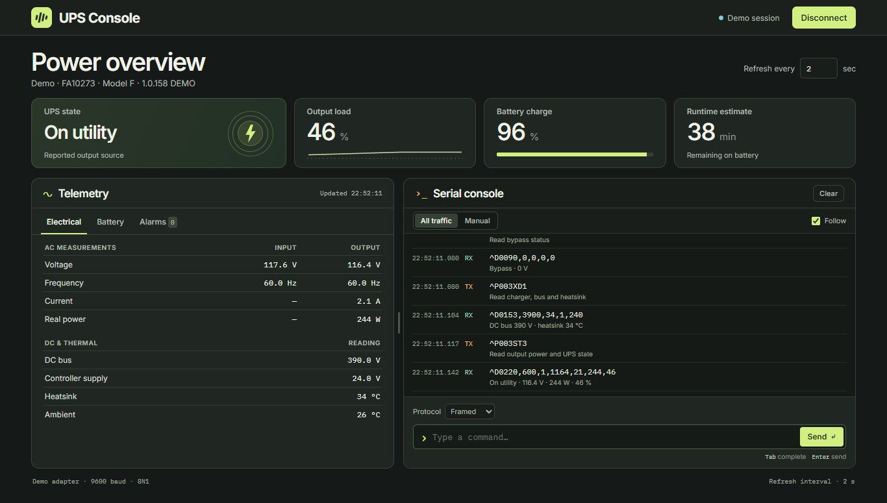

# UPS Console

An offline serial dashboard for the FA10273 Model F and FA10642 dual-board UPS. Monitor the reported power source, input, output, load, battery, runtime, temperatures and alarms while sending commands from the same window.

## Start on Windows

1. Download and extract the repository, then double-click **Start-UPS-Console.cmd**. The launcher serves the bundled app at **http://127.0.0.1:8765/** and opens Edge or Chrome. Keep the launcher window open. Windows PowerShell is sufficient.
2. Click **Try demo** to use a simulated Model F. For a dual-board simulation, select **Connect UPS**, choose the FA10642 profile, then **Start demo**. Demo traffic stays in memory.
3. For hardware, attach the UPS external RS-232 port through the correct serial adapter. Select **Connect UPS**, choose the board profile and baud rate, then **Choose serial port**. Select the adapter in the browser's device chooser. The supplied profiles default to **9600 baud, 8N1, no flow control**.
4. Set **Refresh every** to a positive whole number of seconds and press Enter or leave the field. The default is **2 seconds**. Changes apply during the session and persist in this browser.
5. Click **Disconnect** when finished. Close the launcher window to stop the local server.

On a machine with Python 3 and a desktop browser that supports Web Serial, the same static app can also be served from the repository root.

~~~sh
python -m http.server 8765 --bind 127.0.0.1 --directory app
~~~

Open the loopback address above on the computer attached to the adapter. The browser requires permission to access the port. A managed browser can restrict that permission. All assets, including the fonts, are local. [Chrome Web Serial documentation](https://developer.chrome.com/docs/capabilities/serial) · [Edge serial policy](https://learn.microsoft.com/en-us/deployedge/microsoft-edge-policies/DefaultSerialGuardSetting)

## Read and write commands

| Input | Action |
| --- | --- |
| ST3 or ^P003ST3 | Read the output source, voltage, current, load and power in Framed mode. |
| ST1 | Read the battery report. |
| SET PSD 30 | Schedule shutdown in 30 seconds. This changes UPS operation. Try it in the demo to inspect the transmitted frame and acknowledgment. |
| SET PSD -1 | Cancel a scheduled shutdown. |
| ! | Read converter modes in Britecom mode. |
| :show | Read the FA10273 User-mode settings in Britecom mode. |

Type in the console to see commands for the selected protocol and board. Search by command or description. Arrow keys select a suggestion, **Tab** completes it, and **Enter** sends the completed input. Clicking a suggestion fills the input. With suggestions closed, the arrow keys recall previous submissions. **Manual** shows operator exchanges and **All traffic** includes automatic polling. **Follow** controls scrolling. The console retains the latest 600 entries in memory.

Framed input accepts a three-character poll, a SET with its argument, or a supported complete wire frame. All forms use the same validation. The app calculates the payload length and sends framed commands without a line ending. Britecom preserves command case and sends carriage returns for supported prompts. The console displays carriage return and line feed as **␍** and **␊**.

## Board profiles and recovery

- **FA10273 · Model F** uses the external DSP serial protocol. Select **Model F · UPSilon** only for a unit configured for UPSilon. That profile decodes different battery-charge, load and output-current units.
- **FA10642 · Dual-board router** uses the external router's telemetry and alarm layout. The Battery tab shows both battery strings. In Britecom mode choose **Master** or **Slave**. The router suspends its control loop during pass-through. The app runs one command and its prompt replies, exits pass-through, and verifies framed monitoring before continuing. An unanswered operator prompt takes its cancel option after 30 seconds.
- When a write loses its acknowledgment, the console reports **outcome unknown**. Check the UPS state before deciding whether to reissue it. If a cable is removed during a dual-board text session, reconnect the same adapter with **Restore an interrupted text session on this router** selected.
- If a Model F settings command changes its serial baud rate, disconnect and choose the new rate in the connection dialog.
- The state card displays the source code reported by the UPS. **Other / off / init** represents a shared firmware code. Stale samples retain their receipt times. An empty field is shown as a dash. Closing the tab ends monitoring, and suspending the computer or tab can delay polling.

The catalog covers implemented operating commands for these profiles. Factory and calibration modes, unbounded free-text input, and unreliable firmware status-table handlers are outside its operating command set. On the archived Model F firmware, the framed response-length helper has a known defect. A unit that fails the capability handshake stays in **Checking link**. Verify the installed firmware, baud rate, selected adapter and cabling before relying on live readings.

### Firmware references

Line numbers identify the source snapshots used to build the host implementation.

| Snapshot | File and lines | Behavior |
| --- | --- | --- |
| Model F FA10273 b1.0.158 | TMS320F28069/snmp.c L77–116, L541–919, L921–1529 | Frame arguments, command handlers, source mapping, telemetry fields and units. |
| Model F FA10273 b1.0.158 | TMS320F28069/ups_com.c L154–327, L2437–2452 and app_settings.c L338–351, L513–626 | User parser, case-sensitive commands, prompts and settings. |
| Model F FA10273 b1.0.158 | TMS320F28069/utilities.c L38–54 | Response-length encoding defect. |
| Dual Board FA10642 b1.1.14 | MSP430F5419A/main.c L3245–3336, L3430–3457, L3597–4041, L4043–4314, L8489–8549 | Router pass-through, control-loop suspension, aggregate telemetry, alarms and battery strings. |
| Dual Board FA10642 b1.1.14 | TMS320F28069/dual_board.c L365–381 and ups_com.c L197–269, L1497–1513 | Board-side User-mode entry and operating commands. |

## Verification

Run **npm test** with Node.js 20 or newer. The tests exercise byte framing, both telemetry layouts, command validation, refresh timing, transaction ordering, prompt handling, disconnection and router recovery. No dependencies need to be installed for these tests.

The browser acceptance check runs against a virtual Web Serial adapter in the test browser. With the local launcher running, use the Playwright CLI to open the app and run the check. Repeat with the chrome channel to cover both desktop browsers.

~~~sh
npx --yes --package=@playwright/cli playwright-cli -s=ups-check open http://127.0.0.1:8765 --browser=msedge
npx --yes --package=@playwright/cli playwright-cli -s=ups-check run-code --filename=tests/browser-smoke.pw
npx --yes --package=@playwright/cli playwright-cli -s=ups-check close
~~~

For physical acceptance, connect each UPS family, compare the ST3 source and displayed electrical readings with the unit, and complete a benign Britecom read such as **!**. On the dual-board unit, verify the router return message and a fresh ST3 reply. The simulation and browser checks do not certify a specific unit or adapter.
